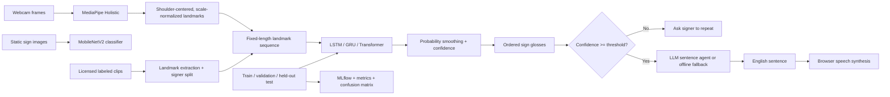

# Real-Time Indian Sign Language Recognition with an Agentic Sentence Layer

A research prototype for recognizing short, isolated sign clips from a webcam and turning a stream of recognized glosses into English text and speech. It provides an end-to-end data, training, evaluation, and demo pipeline; it does **not** include a pretrained model.

> **Current evidence:** The official WLASL v0.3 annotation JSON (ASL) was downloaded and audited; its recorded counts/checksum are in [`reports/runs/wlasl_metadata_audit.json`](reports/runs/wlasl_metadata_audit.json). It contains metadata only; videos were not acquired. Automated INCLUDE access was refused before its license or media could be verified, and Kaggle credentials/CLI were unavailable. No ISL media was acquired, no model was trained, and no recognition accuracy or live latency has been measured. The preprocessing attempt's missing-input evidence is saved in [`reports/runs/preprocessing_blocked_20261013T174000Z.json`](reports/runs/preprocessing_blocked_20261013T174000Z.json). WLASL is ASL, not ISL.

## Problem and scope

Indian Sign Language (ISL) is a natural language used by Deaf communities in India. It is not English rendered as hand gestures and is not interchangeable with American Sign Language. Accessible, community-led language technology can make everyday communication tools more inclusive, but an incorrect translation can also create real barriers. This prototype explores recognizing isolated signs and composing a sign stream into English; it is not a continuous ISL translator.

The candidate starter vocabulary is listed in [`data/target_glosses.txt`](data/target_glosses.txt) with an ISLRTC dictionary source citation. The dictionary's entry-level listing could not be verified here; these are lookup candidates, not attested ISL signs. A fluent ISL signer must verify each dictionary entry, variant, and label before any clips are collected or used for training. English glosses do not represent ISL grammar, facial expression, spatial reference, or signer intent; output must not be relied upon for safety-critical, legal, or medical communication.

## Architecture



**Dynamic model path:** MediaPipe Holistic emits pose and both hand landmarks; pose+hands use 258 float features per frame. Clips are uniformly resampled to a configured sequence length; seeded coordinate noise and hand dropout augment training only. The hands-only ablation uses wrist-centered, palm-scaled hand landmarks and no pose input. Signer IDs are kept disjoint across train/validation/test.

**Static comparison:** MobileNetV2 is fine-tuned on static images using the same signer-independent split discipline. Static and sequence models solve related but different tasks; compare their results only with an explicit modality caveat.

**Sentence agent:** [`src/isl_recognition/agent_loop.py`](src/isl_recognition/agent_loop.py) provides a bounded (maximum five tool actions) tool-calling loop. It supports OpenAI-compatible Chat Completions and Anthropic Messages APIs selected by `LLM_PROVIDER`; low-confidence signs ask for a repeat of that sign only, preserving the rest of the buffer. Vocabulary lookup returns candidate status, and sentence verification combines a rule-based unsupported-content-word guard with an optional LLM judge. Speech is permitted only for a verified sentence. Every step is written to local JSONL files under `reports/agent_traces/` (ignored by Git to avoid publishing potentially sensitive sign sequences). Without API credentials, a deterministic offline sentence fallback runs through the same verification gate.

Run the offline hand-written agent evaluation:

```powershell
python -m tools.evaluate_agent
```

The saved run in [`reports/runs/agent_eval_20261013T164559Z.json`](reports/runs/agent_eval_20261013T164559Z.json) evaluates only the text fallback and repeat gate on authored examples; it is **not** sign-recognition accuracy, a human sign-quality evaluation, or an LLM evaluation. The token-based hallucination guard does not establish semantic faithfulness.

## Datasets and licenses

Dataset acquisition status, provenance, and reproducible instructions are in [`data/sources.md`](data/sources.md).

| Dataset | Language | Local status | Use / restriction |
| --- | --- | --- | --- |
| INCLUDE | Indian Sign Language | No media downloaded; first-party download and license were not verified here | Preferred in-domain data source; obtain from its maintainers and record signer IDs and license |
| WLASL v0.3 | **American Sign Language** | Annotation JSON downloaded to ignored `data/raw/WLASL_v0.3.json`; no videos | Audit log: 2,000 gloss categories and 21,083 annotation instances; metadata only, not training videos; upstream requires reading/agreement to C-UDA 1.0; not ISL |
| Kaggle ISL | Varies by uploader | No dataset selected/downloaded; discovery blocked and license not verified | Choose an exact dataset only after checking uploader, label meanings, license, and signer IDs |

Raw/derived datasets, model weights, credentials, and experiment runs are excluded from Git. Do not redistribute media unless the original provider's terms allow it.

### Attempt automatic acquisition

The acquisition helper tries the official INCLUDE source first, then Kaggle when its CLI/API credentials are available. It refuses unknown-size or unverified-license downloads, filters only matching categories, audits video readability, and reports missing signer metadata instead of guessing it:

```powershell
python -m tools.download_data
```

This machine's attempt is saved at [`reports/runs/data_acquisition_20261013T2244+0530.json`](reports/runs/data_acquisition_20261013T2244+0530.json): INCLUDE refused the request before the data/license could be checked, and Kaggle credentials/CLI were absent. Follow [`data/sources.md`](data/sources.md) and [`docs/STATUS.md`](docs/STATUS.md) for the exact manual unblock steps. No corpus was substituted.

The observed WLASL metadata values and source checksum are recorded in [`reports/runs/wlasl_metadata_audit.json`](reports/runs/wlasl_metadata_audit.json). They are metadata counts, not videos downloaded, ISL examples, or model-training samples.

### Prepare data

Use Python 3.10–3.12 (MediaPipe and PyTorch wheels may not be available for every Python release):

```powershell
py -3.11 -m venv .venv
.\.venv\Scripts\Activate.ps1
python -m pip install --upgrade pip
python -m pip install -e ".[app,train,dev]"
```

Use the webcam recorder only for a separate, consented **held-out live-demo set**. By default, clips and their CSV stay under `data/raw/own/`; never pass this CSV to preprocessing or training:

```powershell
python -m tools.record_clips --signer-id signer_01
# At the review prompt: r replays the clip, d deletes it, q quits.
```

The planned data-collection target is the 20 candidate terms in `data/target_glosses.txt`, with 30 clips per term from at least 3 consenting signers. This is a target only; it is not current dataset size. Have a fluent signer verify the signs first. For **training**, use only a licensed external dataset, for example `data/raw/downloaded/clips.csv`, with `video_path,label,signer_id`; relative paths resolve against that CSV. Never guess missing signer identities. The manifest validator checks media readability, signer counts, class coverage in training, and writes split counts under `reports/`.

```powershell
python -m tools.make_manifest --clips data/raw/downloaded/clips.csv --output data/processed/manifest.csv --report reports/data_manifest.json
python -m src.isl_recognition.data --source-csv data/raw/downloaded/clips.csv --output-dir data/processed
```

The extractor writes one `.npy` sequence per clip and `manifest.csv`. Failed rows are listed in `data/processed/preprocessing_errors.txt`; inspect this file and the output count before training. At least three signers are required. The train command additionally checks that all labels occur in the training partition.

For optional WLASL ASL experiments, first read/agree to the official C-UDA and acquire the source videos under its terms. Once the videos named by the JSON are in `data/raw/wlasl/videos/`, make a top-30-by-available-clip ASL manifest:

```powershell
python -m src.isl_recognition.wlasl_manifest --max-classes 30
python -m src.isl_recognition.data --source-csv data/raw/wlasl_manifest.csv --output-dir data/processed/wlasl
```

For a Kaggle corpus, identify and review its exact data card/license yourself, configure the Kaggle CLI, then use the verified slug:

```powershell
kaggle datasets download -d OWNER/VERIFIED-DATASET-SLUG -p data/raw/kaggle --unzip
```

For static images, arrange samples as `data/raw/static/{train,val,test}/{class_name}/SIGNER_ID__sample.jpg`. The MobileNetV2 trainer requires this filename prefix and verifies signer identities are disjoint across all three splits. Every split must contain each class.

## Train, compare, evaluate

Run the full temporal grid (four architectures, three seeds, two modalities, augmentation on/off, and three sequence lengths). This is a long training job; use the provided Colab notebook if local dependencies or compute are unavailable:

```powershell
python -m src.isl_recognition.train_landmarks --manifest data/processed/manifest.csv --architectures lstm gru transformer tcn --seeds 42 43 44 --modalities hands hands_pose --augmentations on off --sequence-lengths 16 32 48 --epochs 40
```

The best checkpoint is selected by **validation accuracy**, not test performance, and saved as `models/best_landmark.pt` with `models/class_map.json` and `models/MODEL_CARD.md`. Every real run writes a JSON record under `reports/runs/`, per-class metrics, confusion matrix, and top-confusion error analysis under `reports/`, and a local MLflow record under `mlruns/`. `reports/ablation_table.csv` is produced only after actual runs finish and aggregates the observed seeds.

Train the static MobileNetV2 baseline separately (each image filename must encode its pseudonymous signer ID):

```powershell
python -m src.isl_recognition.train_static --data-dir data/raw/static --seeds 42 43 44 --epochs 20
```

Reports include accuracy, macro-F1, per-class precision/recall/F1, confusion matrix, top-five confusion analysis, and model-forward latency/device. Landmark training also measures end-to-end latency on a test clip including MediaPipe extraction if the source video is available; otherwise the run log records why it was not measured. Model-only latency excludes camera capture, network calls, and speech synthesis. Do not compare runs across different splits/vocabularies as if equivalent.

If there is no supported local GPU/training stack, use [`notebooks/train_colab.ipynb`](notebooks/train_colab.ipynb) in Colab. Set its repository URL, mount private Drive containing the real consented clips, then run the cells in order. It does not generate synthetic training examples or metrics.

## Run the local live demo (primary)

After a real landmark model has been trained, launch the OpenCV camera app:

```powershell
python -m src.isl_recognition.live
```

This primary demo detects a sign start after 3 consecutive frames with visible wrists moving at least the default normalized threshold of 0.02, ends a segment after 12 still/no-hand frames, resamples the captured segment to 32 frames, and classifies it once. The 0.8-second cooldown also waits for a stable/no-hand release before rearming. The window shows ready/signing/processing/cooldown, the latest word and confidence, processing FPS, and a running offline sentence; press `q` to exit. Motion threshold, onset-frame count, end-frame count, cooldown, camera index, and model path can be changed with `--help`. The app saves the observed camera-to-displayed-word latency and FPS to `reports/runs/`. It currently stops before camera initialization when the checkpoint is missing; no live run or timing measurement is available.

## Run the secondary Streamlit app

After training a landmark model, run the app:

```powershell
streamlit run app/streamlit_app.py
```

The **Webcam** tab displays the smoothed top sign, confidence bar, processing FPS, per-frame pipeline latency, and stable sign buffer. The **Record and test** tab accepts a short video clip, reports the top classes, measured model-only latency and MediaPipe+model latency, and deletes its temporary upload after inference. No model is included, so neither mode returns predictions until a licensed, trained checkpoint is supplied. Webcam access generally requires localhost or HTTPS; remote deployment may require TURN configuration for WebRTC. No live FPS/latency value has been captured on a real camera in this environment.

Select **Generate and verify sentence** to run the tool-calling loop. The latest tool trace is available in the expandable trace panel. The agent requests a repeat for an individual low-confidence sign and keeps the rest of the buffer. The **Speak sentence** button uses the browser's local Speech Synthesis API after verification.

Optional environment variables:

```powershell
$env:OPENAI_API_KEY = "..."
$env:OPENAI_MODEL = "gpt-4o-mini"
$env:LLM_PROVIDER = "openai" # or anthropic
$env:ANTHROPIC_API_KEY = "..." # required only with LLM_PROVIDER=anthropic
$env:ANTHROPIC_MODEL = "claude-3-5-haiku-latest"
# Optional OpenAI-compatible API endpoint:
$env:OPENAI_BASE_URL = "https://api.openai.com/v1/chat/completions"
# Optional checkpoint override:
$env:ISL_MODEL_PATH = "models/best_landmark.pt"
```

Keys are never stored in the repository. LLM mode sends recognized glosses and sentence-verification prompts to the configured provider; do not enable it for sensitive conversations without reviewing provider data handling.

## Quality checks

Install the project development tools, then run the same checks used by GitHub Actions:

```powershell
python -m pip install -e ".[dev]"
python -m ruff check src tools app tests
python -m black --check src tools app tests
python -m pytest
```

The tests include mocked-provider and deterministic offline-agent cases. Model training, video extraction, live webcam capture, and external API calls require their optional dependencies and relevant data/device/credentials; tests do not claim these end-to-end paths have run. Pytest prints a coverage summary and writes `reports/coverage.xml`. GitHub Actions runs Ruff, Black, and pytest with source coverage on pushes and pull requests.

## Deployment

[`Dockerfile`](Dockerfile) and [`render.yaml`](render.yaml) define a Render Docker web service on port 7860. The image expects a trained checkpoint to be present when built; model weights are git-ignored, so arrange licensed data and weights as a private build artifact/secret or add a controlled download step. Set `OPENAI_API_KEY` in the host's secret environment if LLM mode is required. On the host, configure HTTPS and an appropriate WebRTC TURN relay if browser peers cannot establish a direct media path.

To deploy manually: push the repository to a private/public Git remote as appropriate, create a Render Blueprint from `render.yaml`, provide the checkpoint using a secure artifact workflow, configure secrets, deploy, verify `/_stcore/health`, then test camera access and sentence/audio behavior from the public HTTPS URL. Do not publish trained weights/data until their source terms permit it.

## Results (measured only)

| Model | Dataset/split | Accuracy | Macro F1 | Mean model latency |
| --- | --- | ---: | ---: | ---: |
| MobileNetV2 static | Not run: no labeled image samples | Not measured | Not measured | Not measured |
| BiLSTM landmarks | Not run: no labeled ISL clips | Not measured | Not measured | Not measured |
| BiGRU landmarks | Not run: no labeled ISL clips | Not measured | Not measured | Not measured |
| Transformer landmarks | Not run: no labeled ISL clips | Not measured | Not measured | Not measured |
| TCN landmarks | Not run: no labeled ISL clips | Not measured | Not measured | Not measured |

No score is invented. See [`reports/report.md`](reports/report.md) for the current technical report and outstanding work.

### Agent-only authored-case check

The deterministic offline fallback was run against the hand-written cases in [`tools/evaluate_agent.py`](tools/evaluate_agent.py). The saved [`authored-case agent evaluation`](reports/runs/agent_eval_20261013T164559Z.json) records 25 exact sentence matches in 25 eligible text cases, no unsupported content words flagged by the lexical rule on those examples, and repeat-request precision of 1.0 on the authored low-confidence cases.

A separate, text-only 30-case fixture in [`data/evaluation/agent_independent_cases.json`](data/evaluation/agent_independent_cases.json) was curated independently of the agent implementation and includes 18 ambiguous and 15 noisy cases. The saved [`independent evaluation run`](reports/runs/agent_eval_independent_20261013T172914Z.json) used the deterministic offline provider path (no live LLM credentials/provider call): 20 cases generated sentences and 0/20 (0.0%) were flagged by the configured unsupported-token/verification checks; 10 expected repeat cases produced 10 true positives, 0 false positives, and 0 false negatives (precision 10/10 and recall 10/10). These figures are limited to this fixture and deterministic code path. They are not sign-recognition metrics, human semantic judgments, validated ISL sentences, or evidence of live-LLM performance. The lexical guard cannot prove semantic faithfulness.

### Ablation status

| Ablation dimension | Compared settings | Status |
| --- | --- | --- |
| Input landmarks | Wrist/palm-normalized hands vs. pose + both hands | Implemented; no real runs |
| Augmentation | Coordinate noise/hand dropout on vs. off | Implemented; no real runs |
| Temporal sampling | Sequence lengths 16, 32, and 48 | Implemented; no real runs |
| Model family | BiLSTM, BiGRU, Transformer, and TCN | Implemented; no real runs |
| Seeds | Three default seeds per configuration | Implemented; no real runs |

## Limitations and future work

- Acquire appropriately licensed ISL video/image data, verify mappings with fluent signers, and preserve signer identities for strict generalization tests.
- The current classifier handles isolated gloss clips, not continuous sentence recognition, coarticulation, facial expression, or ISL grammar.
- Domain shift from WLASL/ASL, background, camera viewpoint, hand occlusion, skin/lighting conditions, and signer variation can cause errors.
- Expand signer-diverse capture, calibrate confidence on held-out signers, quantify word-error rates and end-to-end latency, and conduct usability/consent review with the ISL community.
- Add explicit phrase-level datasets and a reviewed ISL-to-English language layer rather than treating gloss concatenation as translation.

## Ethics, consent, and privacy

- Obtain informed consent for every recorded signer and separately for any public release, hosted processing, and derived-weight distribution. Do not capture bystanders. Use pseudonymous signer IDs and keep the identity key offline.
- Raw clips may contain biometric and personally identifying information. This project ignores raw data in Git; keep it access-controlled and delete temporary uploads according to a documented retention policy.
- The optional LLM receives recognized glosses and sentence prompts. Review provider privacy/retention terms before sending sensitive signs. Agent traces are local and ignored by Git because even gloss streams may be sensitive.
- Treat all outputs as uncertain. Use a qualified interpreter for consequential communication, and involve Deaf ISL users in vocabulary, evaluation, and product decisions.

## Reproduce in five steps

These commands assume you have already verified the vocabulary with a fluent signer and acquired licensed external training clips with documented signer IDs. They do not produce a valid model if data/license/signer requirements are unmet. Your own `data/raw/own/` recordings are reserved for a separate held-out live-demo check and are not part of these training commands.

```powershell
# 1. Install in a supported Python environment.
py -3.11 -m venv .venv
.\.venv\Scripts\Activate.ps1
python -m pip install -e ".[app,train,dev]"

# 2. Acquire the verified licensed external dataset; configure Kaggle first if needed.
python -m tools.download_data --kaggle-slug OWNER/VERIFIED-DATASET-SLUG

# 3. Validate signer-independent splits and preprocess that external dataset.
python -m tools.make_manifest --clips data/raw/downloaded/clips.csv --output data/processed/manifest.csv --report reports/data_manifest.json
python -m src.isl_recognition.data --source-csv data/raw/downloaded/clips.csv --output-dir data/processed

# 4. Run the real four-model, three-seed, modality/augmentation/length grid.
python -m src.isl_recognition.train_landmarks --manifest data/processed/manifest.csv --architectures lstm gru transformer tcn --seeds 42 43 44 --modalities hands hands_pose --augmentations on off --sequence-lengths 16 32 48 --epochs 40

# 5. Launch the primary local camera demo (Streamlit is secondary).
python -m src.isl_recognition.live
streamlit run app/streamlit_app.py
```

The complete grid is intentionally substantial. When local training dependencies or hardware are unavailable, use [`notebooks/train_colab.ipynb`](notebooks/train_colab.ipynb). It uploads no synthetic training data.

**Demo GIF placeholder:** `reports/demo.gif` — not recorded because a trained checkpoint and consented camera capture are not available in this environment.
