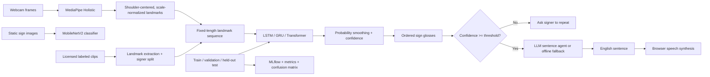

# Real-Time Indian Sign Language Recognition with an Agentic Sentence Layer

A research prototype for recognizing short, isolated sign clips from a webcam and turning a stream of recognized glosses into English text and speech. It provides an end-to-end data, training, evaluation, and demo pipeline; it does **not** include a pretrained model.

> **Current evidence:** The official WLASL v0.3 annotation JSON (ASL) was downloaded and audited; its recorded counts/checksum are in [`reports/runs/wlasl_metadata_audit.json`](reports/runs/wlasl_metadata_audit.json). It contains metadata only; videos were not acquired. No INCLUDE or Kaggle media samples were obtained, no model was trained, and no recognition accuracy or latency has been measured. WLASL is ASL, not ISL.

## Problem and scope

This project explores the two-stage problem of recognizing individual signs and composing a sequence into a natural sentence. The classifier predicts isolated glosses; the sentence layer is not a continuous sign-language translation model. English glosses do not encode ISL grammar, facial expression, spatial reference, or signer intent. Output must not be relied upon for safety-critical, legal, or medical communication.

The candidate starter vocabulary is listed in [`data/target_glosses.txt`](data/target_glosses.txt) with an ISLRTC dictionary source citation. The dictionary's entry-level listing could not be verified here; these are lookup candidates, not attested ISL signs. A fluent ISL signer must verify each dictionary entry, variant, and label before any clips are collected or used for training.

## Architecture



**Dynamic model path:** MediaPipe Holistic emits pose and both hand landmarks; pose+hands use 258 float features per frame. Clips are uniformly resampled to a configured sequence length; seeded coordinate noise and hand dropout augment training only. The hands-only ablation uses wrist-centered, palm-scaled hand landmarks and no pose input. Signer IDs are kept disjoint across train/validation/test.

**Static comparison:** MobileNetV2 is fine-tuned on static images using the same signer-independent split discipline. Static and sequence models solve related but different tasks; compare their results only with an explicit modality caveat.

**Sentence agent:** [`src/isl_recognition/agent_loop.py`](src/isl_recognition/agent_loop.py) provides a bounded (maximum five tool actions) tool-calling loop. It supports OpenAI-compatible Chat Completions and Anthropic Messages APIs selected by `LLM_PROVIDER`; low-confidence signs ask for a repeat of that sign only, preserving the rest of the buffer. Vocabulary lookup returns candidate status, and sentence verification combines a rule-based unsupported-content-word guard with an optional LLM judge. Speech is permitted only for a verified sentence. Every step is written to local JSONL files under `reports/agent_traces/` (ignored by Git to avoid publishing potentially sensitive sign sequences). Without API credentials, a deterministic offline sentence fallback runs through the same verification gate.

Run the offline hand-written agent evaluation:

```powershell
python -m tools.evaluate_agent
```

The saved run in [`reports/runs/agent_eval_20261013T164559Z.json`](reports/runs/agent_eval_20261013T164559Z.json) evaluates only the text fallback and repeat gate on authored examples; it is **not** sign-recognition accuracy, a human sign-quality evaluation, or an LLM evaluation. The token-based hallucination guard does not establish semantic faithfulness.

## Datasets and licenses

Dataset acquisition status, provenance, and reproducible instructions are in [`data/sources.md`](data/sources.md).

| Dataset | Language | Local status | Use / restriction |
| --- | --- | --- | --- |
| INCLUDE | Indian Sign Language | No media downloaded; first-party download and license were not verified here | Preferred in-domain data source; obtain from its maintainers and record signer IDs and license |
| WLASL v0.3 | **American Sign Language** | Annotation JSON downloaded to ignored `data/raw/WLASL_v0.3.json`; no videos | Metadata only; upstream requires reading/agreement to C-UDA 1.0 before academic/computational video use; not ISL |
| Kaggle ISL | Varies by uploader | No dataset selected/downloaded; discovery blocked and license not verified | Choose an exact dataset only after checking uploader, label meanings, license, and signer IDs |

Raw/derived datasets, model weights, credentials, and experiment runs are excluded from Git. Do not redistribute media unless the original provider's terms allow it.

### Prepare data

Use Python 3.10–3.12 (MediaPipe and PyTorch wheels may not be available for every Python release):

```powershell
py -3.11 -m venv .venv
.\.venv\Scripts\Activate.ps1
python -m pip install --upgrade pip
python -m pip install -e ".[app,train,dev]"
```

For consented clips, use the webcam recorder and validator:

```powershell
python -m tools.record_clips --signer-id signer_01
# At the review prompt: r replays the clip, d deletes it, q quits.
python -m tools.make_manifest --clips data/raw/clips.csv
```

The planned data-collection target is the 20 candidate terms in `data/target_glosses.txt`, with 30 clips per term from at least 3 consenting signers. This is a target only; it is not current dataset size. The manifest tool checks media readability, signer counts, class coverage in training, and writes real split counts under `reports/`. For externally sourced licensed clips, prepare `data/raw/clips.csv` with `video_path,label,signer_id`; relative paths resolve against that CSV. Never guess missing signer identities.

```powershell
python -m src.isl_recognition.data --source-csv data/raw/clips.csv --output-dir data/processed
```

The extractor writes one `.npy` sequence per clip and `manifest.csv`. Failed rows are listed in `data/processed/preprocessing_errors.txt`; inspect this file and the output count before training. At least three signers are required. The train command additionally checks that all labels occur in the training partition.

For optional WLASL ASL experiments, first read/agree to the official C-UDA and acquire the source videos under its terms. Once the videos named by the JSON are in `data/raw/wlasl/videos/`, make a top-30-by-available-clip ASL manifest:

```powershell
python -m src.isl_recognition.wlasl_manifest --max-classes 30
python -m src.isl_recognition.data --source-csv data/raw/wlasl_manifest.csv --output-dir data/processed/wlasl
```

For a Kaggle corpus, identify and review its exact data card/license yourself, configure the Kaggle CLI, then use the verified slug:

```powershell
kaggle datasets download -d OWNER/VERIFIED-DATASET-SLUG -p data/raw/kaggle --unzip
```

For static images, arrange samples as `data/raw/static/{train,val,test}/{class_name}/SIGNER_ID__sample.jpg`. The MobileNetV2 trainer requires this filename prefix and verifies signer identities are disjoint across all three splits. Every split must contain each class.

## Train, compare, evaluate

Run the full temporal grid (four architectures, three seeds, two modalities, augmentation on/off, and three sequence lengths). This is a long training job; use the provided Colab notebook if local dependencies or compute are unavailable:

```powershell
python -m src.isl_recognition.train_landmarks --manifest data/processed/manifest.csv --architectures lstm gru transformer tcn --seeds 42 43 44 --modalities hands hands_pose --augmentations on off --sequence-lengths 16 32 48 --epochs 40
```

The best checkpoint is selected by **validation accuracy**, not test performance, and saved as `models/best_landmark.pt` with `models/class_map.json` and `models/MODEL_CARD.md`. Every real run writes a JSON record under `reports/runs/`, per-class metrics, confusion matrix, and top-confusion error analysis under `reports/`, and a local MLflow record under `mlruns/`. `reports/ablation_table.csv` is produced only after actual runs finish and aggregates the observed seeds.

Train the static MobileNetV2 baseline separately (each image filename must encode its pseudonymous signer ID):

```powershell
python -m src.isl_recognition.train_static --data-dir data/raw/static --seeds 42 43 44 --epochs 20
```

Reports include accuracy, macro-F1, per-class precision/recall/F1, confusion matrix, top-five confusion analysis, and model-forward latency/device. Landmark training also measures end-to-end latency on a test clip including MediaPipe extraction if the source video is available; otherwise the run log records why it was not measured. Model-only latency excludes camera capture, network calls, and speech synthesis. Do not compare runs across different splits/vocabularies as if equivalent.

If there is no supported local GPU/training stack, use [`notebooks/train_colab.ipynb`](notebooks/train_colab.ipynb) in Colab. Set its repository URL, mount private Drive containing the real consented clips, then run the cells in order. It does not generate synthetic training examples or metrics.

## Run the webcam app

After training a landmark model, run the app:

```powershell
streamlit run app/streamlit_app.py
```

The **Webcam** tab displays the smoothed top sign, confidence bar, processing FPS, per-frame pipeline latency, and stable sign buffer. The **Record and test** tab accepts a short video clip, reports the top classes, measured model-only latency and MediaPipe+model latency, and deletes its temporary upload after inference. No model is included, so neither mode returns predictions until a licensed, trained checkpoint is supplied. Webcam access generally requires localhost or HTTPS; remote deployment may require TURN configuration for WebRTC. No live FPS/latency value has been captured on a real camera in this environment.

Select **Generate and verify sentence** to run the tool-calling loop. The latest tool trace is available in the expandable trace panel. The agent requests a repeat for an individual low-confidence sign and keeps the rest of the buffer. The **Speak sentence** button uses the browser's local Speech Synthesis API after verification.

Optional environment variables:

```powershell
$env:OPENAI_API_KEY = "..."
$env:OPENAI_MODEL = "gpt-4o-mini"
$env:LLM_PROVIDER = "openai" # or anthropic
$env:ANTHROPIC_API_KEY = "..." # required only with LLM_PROVIDER=anthropic
$env:ANTHROPIC_MODEL = "claude-3-5-haiku-latest"
# Optional OpenAI-compatible API endpoint:
$env:OPENAI_BASE_URL = "https://api.openai.com/v1/chat/completions"
# Optional checkpoint override:
$env:ISL_MODEL_PATH = "models/best_landmark.pt"
```

Keys are never stored in the repository. LLM mode sends recognized glosses and sentence-verification prompts to the configured provider; do not enable it for sensitive conversations without reviewing provider data handling.

## Tests

Core preprocessing, signer split, smoothing, confidence gate, and the LLM response parser have standard-library unit tests:

```powershell
python -m unittest discover -s tests -v
```

Model training, video extraction, live webcam capture, and external API calls require their optional dependencies and relevant data/device/credentials; unit tests do not claim these end-to-end paths have run.

## Deployment

[`Dockerfile`](Dockerfile) and [`render.yaml`](render.yaml) define a Render Docker web service on port 7860. The image expects a trained checkpoint to be present when built; model weights are git-ignored, so arrange licensed data and weights as a private build artifact/secret or add a controlled download step. Set `OPENAI_API_KEY` in the host's secret environment if LLM mode is required. On the host, configure HTTPS and an appropriate WebRTC TURN relay if browser peers cannot establish a direct media path.

To deploy manually: push the repository to a private/public Git remote as appropriate, create a Render Blueprint from `render.yaml`, provide the checkpoint using a secure artifact workflow, configure secrets, deploy, verify `/_stcore/health`, then test camera access and sentence/audio behavior from the public HTTPS URL. Do not publish trained weights/data until their source terms permit it.

## Results (measured only)

| Model | Dataset/split | Accuracy | Macro F1 | Mean model latency |
| --- | --- | ---: | ---: | ---: |
| MobileNetV2 static | Not run: no labeled image samples | Not measured | Not measured | Not measured |
| LSTM landmarks | Not run: no labeled ISL clips | Not measured | Not measured | Not measured |
| GRU landmarks | Not run: no labeled ISL clips | Not measured | Not measured | Not measured |
| Transformer landmarks | Not run: no labeled ISL clips | Not measured | Not measured | Not measured |
| TCN landmarks | Not run: no labeled ISL clips | Not measured | Not measured | Not measured |

No score is invented. See [`reports/report.md`](reports/report.md) for the current technical report and outstanding work.

## Limitations and future work

- Acquire appropriately licensed ISL video/image data, verify mappings with fluent signers, and preserve signer identities for strict generalization tests.
- The current classifier handles isolated gloss clips, not continuous sentence recognition, coarticulation, facial expression, or ISL grammar.
- Domain shift from WLASL/ASL, background, camera viewpoint, hand occlusion, skin/lighting conditions, and signer variation can cause errors.
- Expand signer-diverse capture, calibrate confidence on held-out signers, quantify word-error rates and end-to-end latency, and conduct usability/consent review with the ISL community.
- Add explicit phrase-level datasets and a reviewed ISL-to-English language layer rather than treating gloss concatenation as translation.
